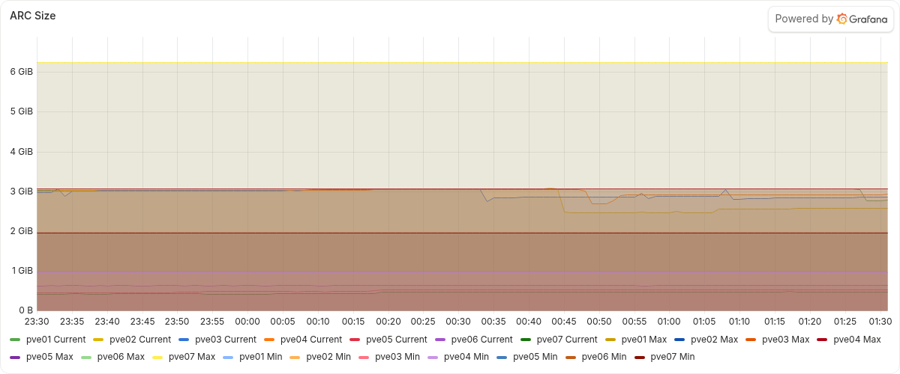
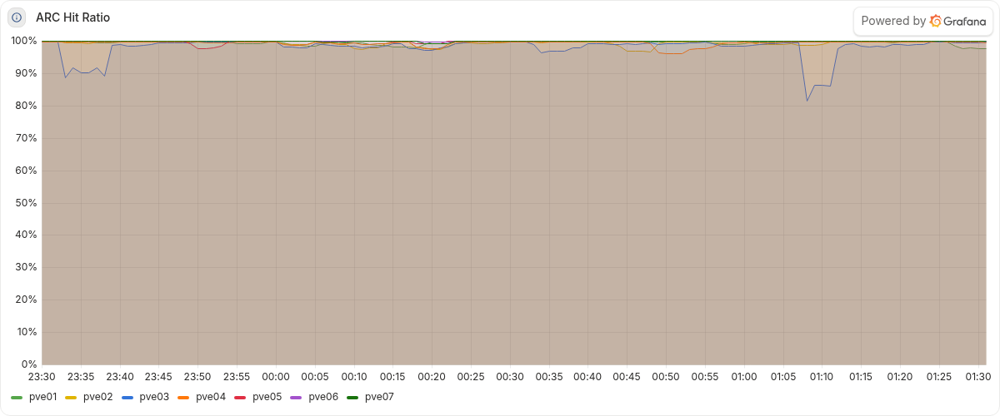

# OFF-1446 QA evidence

Deployment review of "Trim unused ZFS node series from Blackstar Alloy, keeping the ARC and zpool series".

- Build: `main` 8a13279 (merge of PR #62, reviewed head 82bac37).
- Environment: Blackstar pve01-pve07 and Grafana Cloud stack 1389009.
- Change applied: pve01 at 00:13Z, pve02-pve07 between 00:16Z and 00:18Z on 2026-11-09.
- Fixtures: none.
  All checks are read-only queries against metrics, dashboards and alert rules.
- Verified: 2026-11-09, around 01:35Z.
- Raw query output is attached to the Linear story.

## Verdicts

| Item | Verdict | Evidence |
| -- | -- | -- |
| AC1 | Met | The six kept names have 12 series per node before (00:10Z) and after (01:27Z), with identical label sets (84 in total). `node_zfs_*` fell from 3,315 to 84 series, a drop of 3,231 that equals the pre-change count of the other 315 names. No series carries `__tmp_zfs_keep`. Only the Blackstar Node Health dashboard uses ZFS names, and no alert or recording rule does. |
| AC2 | Met | All 10 Node Health rules were Normal before and after, with no state transitions since 00:00Z. The enp8s0 label sets are identical on pve05-pve07, and the AER label sets are identical on pve05-pve07. On pve01-pve04 the AER series went from 0 to 21, 9, 9 and 12, with none removed, because this deploy also applied the AER exporter (d0102a8) to those nodes for the first time. |
| AC3 | Met | All 138 panels on 8 dashboards return data on the same nodes in 23:10-00:10Z and 00:31-01:31Z, with no query errors. Nine panels have no data on any node in either window. |
| AC4 | Met | The comment in `roles/alloy/templates/config.alloy.j2` names the series group, 3,231 series, 2026-11-08, the six kept names, and why three rules are needed. |
| AC5 | Met | The validation command and the rollback are stated on the story. pve01 changed first (00:13:11Z), and pve02-pve07 followed between 00:16:25Z and 00:17:42Z. `up` stayed 1 on all seven nodes over the 70 minutes before 01:34Z. |
| AC6 | Met | The active series median was 6,177 at 01:34Z, against 9,360.5 for the hour before the change. |
| DoD | Met | 30 tests pass and 1 is skipped (`ALLOY_BIN` unset) at 8a13279. The review of record on 82bac37 was posted before the merge. No docs describe the series set, so the template comment is the documentation. No regressions were found. |

## Screenshots

Blackstar Node Health, ARC Size, 2026-11-08 23:30Z to 2026-11-09 01:31Z.
Current, Max and Min continue across the change on all seven nodes.

Blackstar Node Health, ARC Hit Ratio, same window.

